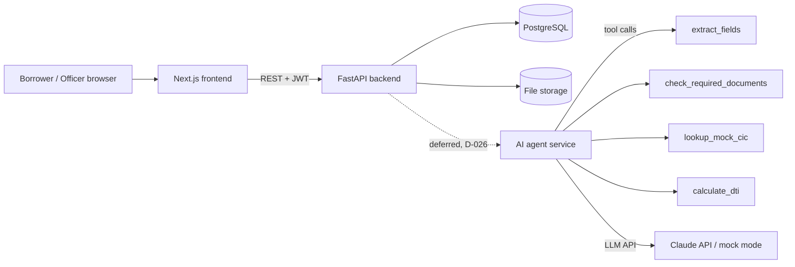

# LendFlow

> A digital lending application built as an end-to-end portfolio project: **business analysis + fullstack engineering**, designed around Vietnamese lending and data-protection rules.

**Status:** Documentation complete (v0.1). Backend implementation in progress; per-story status is in the [backlog](docs/04-user-stories-backlog.md#1-backlog-overview-moscow), and the reasons behind each choice are in the [decisions log](docs/08-decisions-log.md). The frontend is set up (Next.js shell, API proxy, login session handling); screens are built story by story.
**Live demo:** _coming soon_ · **Demo video:** _coming soon_

> LendFlow is a **fictional lender** for educational purposes. It uses **synthetic data only** and is not a financial product or legal advice.

## The problem

Borrowers don't know how much they can borrow or where their application stands. Loan officers re-type the same ID number three times, wait minutes for credit checks with no feedback, and phone supervisors for non-standard income. Approvals stall, and nobody can easily show who decided what and why.

## The solution

- A public **loan calculator** (reducing-balance annuity).
- Online **application with explicit consent** (purposes including credit scoring; the AI-processing purpose is retained for a later release).
- **Document upload** with type and size validation. *(AI extraction of ID fields is deferred, D-026.)*
- **Rules by income type** (salaried, freelance, self-employed, rental) with required documents.
- **Mock credit-bureau check** with a progress indicator.
- **Human decisions only**: a loan officer or supervisor always decides. *(The advisory AI review summary is deferred, D-026.)*
- **Officer queue**, **supervisor escalation**, **decision with reason code**, **borrower status tracker**.
- **Audit log**, **data-subject rights**, **CSV bulk import**.

## What this project demonstrates

| Skill area | Evidence in this repo |
|---|---|
| **Business analysis** | Brief, stakeholder analysis, business rules, As-Is/To-Be process, 20-story backlog with MoSCoW, compliance matrix, traceability |
| **Fullstack** | Next.js + TypeScript frontend; FastAPI + PostgreSQL backend; JWT auth with RBAC; CRUD; file upload and CSV import; CI/CD |
| **Applied AI** | Deferred (D-026). Design kept: mock mode, cost controls, human-in-the-loop |
| **Product thinking** | Measurable objectives, scope cuts documented in a decisions log |
| **Compliance awareness** | Mapping of Vietnamese lending, e-transaction and personal-data rules to features and tests |

## Documentation

| Document | Purpose |
|---|---|
| [00 Project brief](docs/00-project-brief.md) | Problem, vision, objectives, scope, risks, plan |
| [01 Stakeholders and RBAC](docs/01-stakeholders-and-rbac.md) | Power/interest grid, roles, permission matrix |
| [02 Business rules](docs/02-business-rules.md) | Eligibility, routing, AI and data rules; worked calculation |
| [03 Process: As-Is and To-Be](docs/03-process-as-is-to-be.md) | Process diagrams, pain points, gap analysis, state machine |
| [04 User stories and backlog](docs/04-user-stories-backlog.md) | 20 stories with acceptance criteria, MoSCoW |
| [05 Compliance matrix](docs/05-compliance-matrix.md) | Legal requirement to feature to test |
| [06 Data model](docs/06-data-model.md) | ER diagram and data dictionary |
| [07 Glossary](docs/07-glossary.md) | Bilingual (EN/VI) terms |
| [08 Decisions log](docs/08-decisions-log.md) | Why key choices were made; open questions |

## Architecture (planned)



## Tech stack

Next.js · TypeScript · Tailwind · FastAPI · SQLAlchemy · Alembic · PostgreSQL · pytest · Playwright · Docker · GitHub Actions · Anthropic API

## Cost approach

Free-tier hosting, mock AI mode by default, cheapest model that passes the evals, free OCR first, monthly AI spend cap, per-request cost logging.

## Roadmap

| Week | Focus |
|---|---|
| 1 | Discovery, process diagrams, brief |
| 2 | Requirements, rules, RBAC, data model, compliance matrix |
| 3 | Skeleton: auth and roles, deployed shell, calculator |
| 4 | Application workflow, status tracker, officer queue |
| 5 | Upload, CSV import, mock CIC (AI review agent deferred, D-026) |
| 6 | Tests, security pass, UAT cases (evals deferred, D-026) |
| 7 | README polish, demo video, case study |

## Getting started

Backend only so far. You need [Docker](https://www.docker.com/) (for Postgres) and [uv](https://docs.astral.sh/uv/) (it installs Python 3.12 for you).

```bash
docker compose up -d --wait               # Postgres 16 on host port 5433 (lendflow + lendflow_test)

cp .env.example backend/.env              # then set JWT_SECRET (32+ characters), e.g.
python3 -c "import secrets; print(secrets.token_urlsafe(48))"

cd backend
uv sync
uv run alembic upgrade head               # create the schema and seed the document rules
uv run python -m scripts.seed_users       # synthetic officer and supervisor (prints a password)
uv run fastapi dev app/main.py            # API on http://localhost:8000, docs at /docs

uv run pytest                             # tests (migrates and uses lendflow_test)
uv run ruff check .                       # lint
```

Notes:

- Uploaded files are stored under `STORAGE_DIR` (default `backend/storage`, git-ignored).
- The audit log is append-only by design, so its rows cannot be deleted. To reset the dev database, run `docker compose down -v` and start again from the top.
- AI features (LF-006, LF-009) are deferred to a later release (D-026); `AI_MODE` defaults to `mock`.

## Responsible-use notes

- The AI never approves or rejects; humans decide and every AI output is logged.
- Only synthetic data is accepted; do not upload real documents.
- Legal references were compiled from secondary sources and need verification against official texts (see the compliance matrix).

## Author

**Vy**: frontend developer moving into fullstack and product-focused roles.
