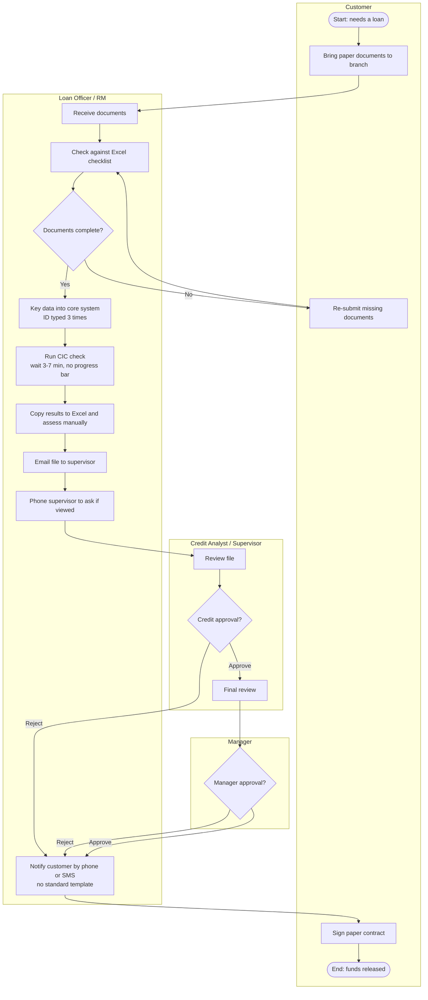
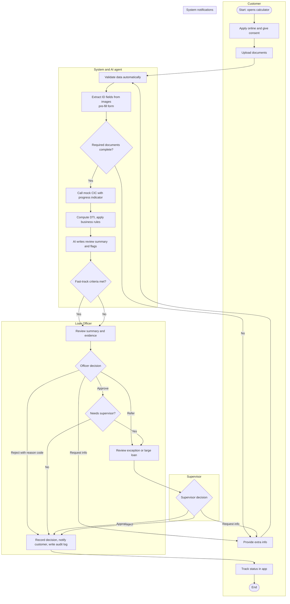
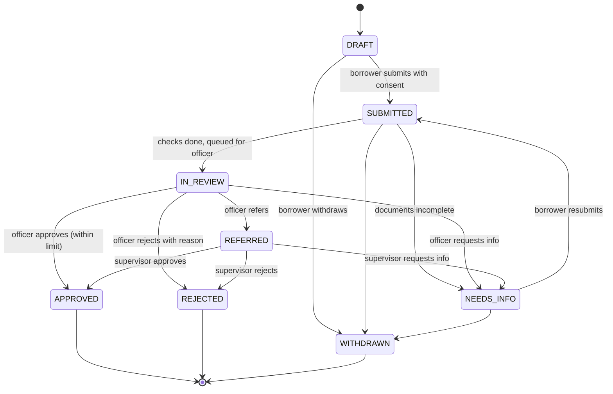

# Process Analysis: As-Is and To-Be

> The diagrams below are written in **Mermaid** so they render on GitHub and can be version-controlled. For the BPMN 2.0 deliverable required by the bootcamp homework, redraw them in **draw.io** (BPMN shapes, swimlanes, gateways) using these as the specification, and export PNGs into `docs/img/`.

## 1. As-Is: current lending process (paper and manual)

Swimlanes: Customer, Loan Officer (RM), Credit Analyst/Supervisor, Manager.

### As-Is pain points (from elicitation)

| # | Step | Pain point | Root cause | Addressed by |
|---|---|---|---|---|
| 1 | Documents | Missing documents discovered late; customer returns | No automated checklist | LF-007 |
| 2 | Data entry | ID typed 3 times | No data sharing between forms | LF-006 |
| 3 | CIC check | 3-7 minute wait with no feedback | No progress indicator | LF-008 |
| 4 | Assessment | Copying between screens and Excel | No integrated view | LF-009 |
| 5 | Hand-off | Unknown whether supervisor saw the file | No tracking or notification | LF-012 |
| 6 | Approval | Files wait up to 3 days | No SLA or escalation | LF-017 |
| 7 | Notification | Inconsistent messages to customers | No templates | LF-011 |
| 8 | Non-standard income | About 30% of files need a phone call | No rule for freelance / self-employed | LF-007 |
| 9 | Rejection | Customer gets no reason | No reason-code requirement | LF-011 |
| 10 | Governance | No audit trail | Manual steps | LF-016 |

## 2. To-Be: LendFlow process

Swimlanes: Customer, System (including the AI agent), Loan Officer, Supervisor.

Notes:

- Fast-track (BR-09) changes **routing**, not the need for a human decision. It sends the file to the officer with a "one-step confirm" view and skips the supervisor.
- Every transition writes an **audit log** entry (LF-016).

## 3. Gap analysis (As-Is to To-Be)

| Dimension | As-Is | To-Be | Gap closed by |
|---|---|---|---|
| Intake | Paper | Online application with consent | LF-004, LF-005 |
| Data entry | Typed repeatedly | Extracted once, editable | LF-006 |
| Document check | Excel checklist | Rules by income type | LF-007 |
| Credit check | Opaque wait | Progress with estimate | LF-008 |
| Assessment | Manual copy to Excel | AI summary + rules | LF-009 |
| Routing | Email and phone | Queue, thresholds, escalation | LF-010, LF-017 |
| Decision | Unstructured | Four outcomes with reason codes | LF-011 |
| Customer feedback | Phone call | Live status tracker | LF-012 |
| Governance | None | Immutable audit log | LF-016 |

## 4. Application status state machine

**Borrower-facing status mapping** (from LOAN-02): Received (SUBMITTED) → Under assessment (IN_REVIEW, NEEDS_INFO) → Awaiting approval (REFERRED) → Completed (APPROVED, REJECTED).
