# Data Model (conceptual, draft)

Database: PostgreSQL. All personal data is synthetic.

```mermaid
erDiagram
  USERS ||--o| BORROWER_PROFILES : has
  USERS ||--o{ APPLICATIONS : "creates or reviews"
  BORROWER_PROFILES ||--o{ APPLICATIONS : submits
  APPLICATIONS ||--o{ DOCUMENTS : contains
  DOCUMENTS ||--o{ EXTRACTIONS : "analysed into"
  APPLICATIONS ||--o{ CIC_CHECKS : triggers
  APPLICATIONS ||--o{ AI_REVIEWS : receives
  APPLICATIONS ||--o{ OUTBOX : "notifies about"
  APPLICATIONS ||--o{ DECISIONS : "ends with"
  APPLICATIONS ||--o{ STATUS_HISTORY : tracks
  USERS ||--o{ CONSENTS : gives
  USERS ||--o{ AUDIT_LOGS : "performs"
  USERS ||--o{ DATA_REQUESTS : files
  INCOME_TYPE_RULES ||--o{ REQUIRED_DOCUMENT_RULES : defines
  REQUIRED_DOCUMENT_RULES ||--|{ REQUIRED_DOCUMENT_OPTIONS : "satisfied by any of"
  APPLICATIONS ||--o{ APPLICATION_EXCEPTIONS : "has declared"
  REQUIRED_DOCUMENT_RULES ||--o{ APPLICATION_EXCEPTIONS : "waived by"
  IMPORT_JOBS ||--o{ APPLICATIONS : creates

  USERS {
    uuid id PK
    string email UK
    string password_hash
    string role "borrower | officer | supervisor"
    bool is_active
    datetime created_at
  }
  BORROWER_PROFILES {
    uuid id PK
    uuid user_id FK
    string full_name
    date date_of_birth
    string national_id "12 digits, synthetic"
    string address
    string income_type
    numeric monthly_income_vnd
    numeric existing_debt_payment_vnd
  }
  APPLICATIONS {
    uuid id PK
    uuid borrower_profile_id FK
    uuid created_by FK
    numeric amount_vnd
    int term_months
    numeric annual_rate
    string purpose
    string income_type "snapshot at submission; drives the document checklist"
    string status "see state machine"
    bool fast_track "BR-09; false until LF-008/LF-009 compute it"
    bool high_dti "BR-07; false until LF-008/LF-009 compute it"
    bool exception_flag
    uuid assigned_officer FK
    uuid assigned_supervisor FK "set automatically for exception files"
    datetime submitted_at
  }
  DOCUMENTS {
    uuid id PK
    uuid application_id FK
    string doc_type
    string storage_key
    string mime_type
    int size_bytes
    datetime uploaded_at
    datetime delete_after
  }
  EXTRACTIONS {
    uuid id PK
    uuid document_id FK
    json fields "name, dob, id_number, address"
    json confidence
    string method "ocr | llm | mock"
    datetime created_at
  }
  CIC_CHECKS {
    uuid id PK
    uuid application_id FK
    int debt_group "1-5"
    string status "running | done | timeout"
    int progress_pct
    datetime started_at
    datetime finished_at
  }
  AI_REVIEWS {
    uuid id PK
    uuid application_id FK
    string model
    string config_version
    json summary
    json flags
    numeric cost_usd
    string mode "live | mock"
    datetime created_at
  }
  DECISIONS {
    uuid id PK
    uuid application_id FK
    bigint seq "database insertion order; defines the latest decision"
    uuid decided_by FK
    string outcome "approve | reject | request_info | refer"
    string reason_code
    text explanation
    text conditions "documents or conditions that could change a rejection (BR-13)"
    uuid supersedes_id FK
    datetime decided_at
  }
  STATUS_HISTORY {
    uuid id PK
    uuid application_id FK
    string from_status
    string to_status
    uuid actor_id FK
    datetime changed_at
  }
  OUTBOX {
    uuid id PK
    uuid recipient_user_id FK "address is looked up by id, never stored here"
    uuid application_id FK
    string template "queued | info_requested | resubmitted | approved | rejected"
    string subject
    text body "status line and link only; no amounts, names or decision text"
    datetime created_at
  }
  CONSENTS {
    uuid id PK
    uuid user_id FK
    string consent_version
    json purposes
    datetime given_at
    datetime withdrawn_at
  }
  AUDIT_LOGS {
    uuid id PK
    bigint seq UK "insertion order, assigned by the database"
    uuid actor_id FK
    string action
    string target_type
    uuid target_id
    uuid application_id FK "the application the entry belongs to, if any"
    string ip_address
    datetime created_at
  }
  DATA_REQUESTS {
    uuid id PK
    uuid user_id FK
    string type "export | correct | delete"
    string status
    date due_date
  }
  INCOME_TYPE_RULES {
    string income_type PK "salaried | freelance | self_employed | rental | other"
    string label
    bool needs_supervisor_if_missing "a mandatory document declared unavailable makes the file an exception"
    bool supervisor_always "Other: always assigned to a supervisor"
  }
  REQUIRED_DOCUMENT_RULES {
    uuid id PK
    string income_type FK
    string label "e.g. Labour contract or employer confirmation"
    bool mandatory
    int sort_order
  }
  REQUIRED_DOCUMENT_OPTIONS {
    uuid rule_id PK, FK
    string doc_type PK "any ONE of a requirement's options satisfies it"
  }
  APPLICATION_EXCEPTIONS {
    uuid id PK
    uuid application_id FK
    uuid requirement_id FK
    uuid declared_by FK
    datetime declared_at
  }
  IMPORT_JOBS {
    uuid id PK
    uuid created_by FK
    string file_hash
    int rows_ok
    int rows_failed
    datetime created_at
  }
```

## Design notes

- `AUDIT_LOGS` and `DECISIONS` are **append-only**: no update or delete endpoints; the application's database role has no UPDATE/DELETE privilege on them.
- `DECISIONS.supersedes_id` supports corrections without erasing history (BR-14).
- `DOCUMENTS.delete_after` implements the retention rule (BR-23); a scheduled job deletes expired files.
- `AI_REVIEWS` stores model, configuration version, cost and mode for traceability (BR-16, BR-19, BR-20).
- Thresholds and rules live in configuration tables (`INCOME_TYPE_RULES`, `REQUIRED_DOCUMENT_RULES`) so the supervisor can change them without code changes.
- Store money as integer VND or `numeric`, never floating point.

## Data dictionary highlights

| Field | Meaning | Rule |
|---|---|---|
| `national_id` | National citizen ID number (synthetic) | 12 digits (BR-04) |
| `income_type` | Salaried, Freelance, Self-employed, Rental, Other | Drives required documents (BR-06) |
| `debt_group` | Credit-bureau debt classification | 1 = standard, 5 = loss; groups 3 to 5 = bad debt |
| `fast_track` | Routing flag | Computed from BR-09 (not yet computed; false) |
| `high_dti` | Routing flag | Computed from BR-07 (not yet computed; false) |
| `exception_flag` | Needs supervisor | Missing mandatory document, or BR-10 |
